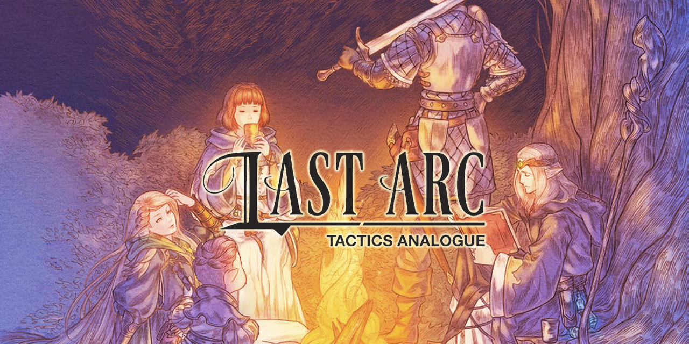

# Last Arc: Tactics Analogue — Character Companion

<div align="center">
  <a href="https://last-arc.brianjamiel.dev">
    
  </a>
</div>

### Your adventure. Your character. Your companion.

**A free, open-source, offline-ready character companion for Last Arc: Tactics Analogue.**

Build characters, manage combat, roll dice, and export character data for Foundry VTT.


**[Launch Character Companion](https://last-arc.brianjamiel.dev)** · **[Report a Bug](../../issues/new)** · **[Request a Feature](../../issues/new)**

</div>

---

## About the Project

**Last Arc: Tactics Analogue — Character Companion** is an independent, community-driven application designed to simplify character management and gameplay.

Built with modern web technologies, the application brings character statistics, combat resources, equipment management, and dice mechanics into a single responsive interface.

The goal is straightforward: **Spend less time managing your character sheet and more time enjoying your adventure.**

The application is free, open source, and designed to work across desktop and mobile devices.

## Features

### Character Management

- Digital character sheets with persistent storage.
- Character attributes, skills, and derived statistics.
- Equipment and inventory tracking.
- Character notes and resource management.
- Character options from supported Last Arc sourcebooks.

### Combat Companion

- HP and MP tracking.
- Break Gauge and Break Threshold management.
- Automated defense calculations.
- Weapon and equipment statistics.
- Integrated combat-related calculations.

### Dice and Skills

- Exploding dice roller.
- Skill calculations and auditing.
- Character-based modifiers.
- Support for applicable attack roll skills.

### Foundry VTT Interoperability

- Character JSON import and export.
- Foundry-compatible character data structures.
- Equipment and character attribute serialization.
- Foundation for expanded Foundry VTT integration.

*Foundry interoperability is under active development. Full synchronization is not yet guaranteed.*

### Progressive Web Application

- Offline-capable application.
- Responsive desktop and mobile layouts.
- Locally persisted character data.
- Installable PWA architecture.
- No account required for local character management.

## Application Preview

Explore the Character Companion interface.

### Character Sheet


### Combat Management


### Dice Roller


*Screenshots will be added as the interface is documented.*

## Technology Stack

| Technology | Purpose |
|---|---|
| React 19 | User interface |
| TypeScript | Type-safe application development |
| Vite | Development and build tooling |
| Tailwind CSS v4 | Styling and responsive design |
| Zustand | Application state management |
| Vite PWA | Offline support and installation |
| Lucide React | Interface iconography |
| Cloudflare Pages | Application hosting |

## Getting Started

### Use the Application

No development environment is required to use the hosted application.

**[Open Last Arc Character Companion](https://last-arc.brianjamiel.dev)**

### Local Development

**Prerequisites**

- Node.js (a version compatible with the repository's configuration)
- npm
- Git

Clone the repository:

```bash
git clone <YOUR_REPOSITORY_URL>
cd <YOUR_REPOSITORY_DIRECTORY>
```

Install dependencies:

```bash
npm install
```

Start the development server:

```bash
npm run dev
```

Build for production:

```bash
npm run build
```

Run the test suite:

```bash
npm test
```

*Check `package.json` for the exact test command configured by the project.*

## Development Roadmap

The project is currently in pre-1.0 development.

### Current Priorities

- [ ] Verify and correct Break Gauge calculations.
- [ ] Improve weapon damage modifier calculations.
- [ ] Expand Spellcraft attack roll options.
- [ ] Continue automated regression testing.
- [ ] Improve character sheet accessibility.
- [ ] Expand Foundry VTT interoperability.
- [ ] Refine mobile and PWA installation behavior.

Future milestones will be documented in `ROADMAP.md` when available.

See [CHANGELOG.md](CHANGELOG.md) for development history and release notes.

## Contributing

Community contributions are welcome.

Whether you're a developer, TTRPG player, tester, or someone who has identified an issue, your feedback can help improve the Character Companion.

Please review the following documents before contributing:

- [Contribution Guidelines](CONTRIBUTING.md)
- [Code of Conduct](CODE_OF_CONDUCT.md)
- [Security Policy](SECURITY.md)

You can also open a GitHub Issue to report bugs or suggest improvements.

## Security

If you discover a security vulnerability, please follow the responsible disclosure instructions in [SECURITY.md](SECURITY.md).

Avoid publicly disclosing vulnerabilities before they have been reviewed.

## License

This application's original source code is distributed under the [MIT License](LICENSE).

The MIT License applies to the original software implementation and does not grant rights to third-party game content, trademarks, or other intellectual property.

## Disclaimer

This is an independent, unofficial, community-created companion application for **Last Arc: Tactics Analogue**.

Last Arc: Tactics Analogue and associated intellectual property belong to their respective rights holders.

This project is not officially affiliated with, endorsed by, or sponsored by Succubus Publishing.

## Author and Maintainer

**Designed, Engineered & Maintained by Brian T Jamiel (6R3M)**

[Developer Website](https://brianjamiel.dev) · [Launch Application](https://last-arc.brianjamiel.dev)

---

<div align="center">

**Built for the Last Arc community.**

*An independent open-source project.*

</div>
